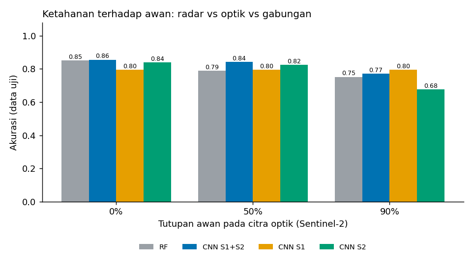
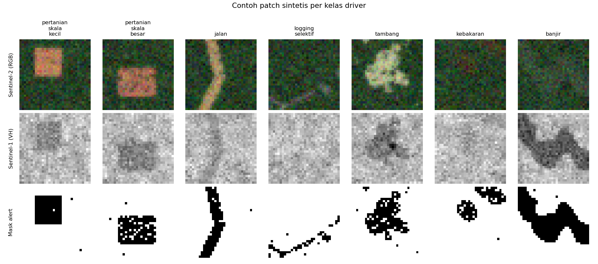

# Klasifikasi Driver Deforestasi dari Alert Satelit (Sentinel-1 + Sentinel-2)

Studi kasus berdasarkan seminar **Dr. Bart Slachter (Wageningen University and Research)** tentang
*deforestation alerts* dan klasifikasi *direct driver* (pertanian, jalan, logging, tambang, kebakaran, banjir)
memakai citra radar dan optik serta CNN.

> **Catatan penting:** seluruh data pada repositori ini **sintetis**. Hasil di bawah menunjukkan alur kerja dan
> pola perilaku model pada simulator, bukan akurasi pada citra Sentinel nyata.

Dokumen lengkap (latar belakang, rumusan masalah, pemetaan materi, metode, hasil, keterbatasan):
[`docs/studi_kasus.md`](docs/studi_kasus.md)

## Pertanyaan yang diuji

1. **Benchmark:** apakah CNN lebih baik daripada Random Forest dengan fitur buatan tangan? (saran pembicara: selalu bandingkan dengan metode konvensional)
2. **Ablasi sensor:** bagaimana radar saja, optik saja, dan gabungan ketika tutupan awan 0%, 50%, 90%?
3. **Ambang keyakinan:** bagaimana trade-off cakupan dan akurasi bila alert yang tidak meyakinkan diberi label "tidak pasti"?

## Hasil ringkas (data sintetis, satu seed, 1.050 patch uji)

| Model | Awan 0% | Awan 50% | Awan 90% |
|---|---|---|---|
| Random Forest | 0,851 | 0,790 | 0,752 |
| CNN S1+S2 | 0,856 | 0,842 | 0,771 |
| CNN S1 (radar) | 0,795 | 0,795 | 0,795 |
| CNN S2 (optik) | 0,839 | 0,824 | 0,676 |

Poin yang layak dicatat: selisih CNN vs RF pada langit cerah masih dalam rentang derau (galat baku ≈ 1,1 poin);
optik unggul saat cerah tetapi runtuh pada awan tebal; model gabungan pada awan 90% sedikit di bawah radar saja;
menaikkan ambang keyakinan dari 0,5 ke 0,9 menaikkan akurasi alert berlabel dari 85,6% ke 98,6% dengan cakupan turun dari 97,1% ke 40,2%.
Penjelasan dan keterbatasan ada di dokumen studi kasus.




## Struktur

```
src/
  config.py         kelas, pita citra, subset kanal
  simulate_data.py  simulator patch sintetis + awan
  features.py       27 fitur untuk baseline Random Forest
  models.py         CNN kecil (PyTorch, ±36 ribu parameter)
  train.py          eksperimen 1-3, menyimpan hasil ke results/
  evaluate.py       grafik (confusion matrix, ablasi awan, ambang keyakinan)
  predict.py        simulasi alur bulanan: driver + keyakinan + label tidak_pasti
tests/test_pipeline.py
docs/studi_kasus.md
results/            metrics.json, laporan klasifikasi, grafik
models/cnn_s1s2.pt  bobot CNN S1+S2
```

## Cara menjalankan

```bash
python -m venv .venv && source .venv/bin/activate     # Windows: .venv\Scripts\activate
pip install -r requirements.txt

python src/train.py --quick        # uji cepat (sekitar 1 menit di CPU)
python src/train.py                # hasil penuh (sekitar 6 menit di CPU 1 core)
python src/predict.py --awan 0.5 --tau 0.6
pytest -q
```

Parameter `train.py`: `--n-train`, `--n-test`, `--epochs`, `--seed`, `--out`. Hasil dapat sedikit berbeda antar
mesin karena perbedaan versi library dan CPU.
